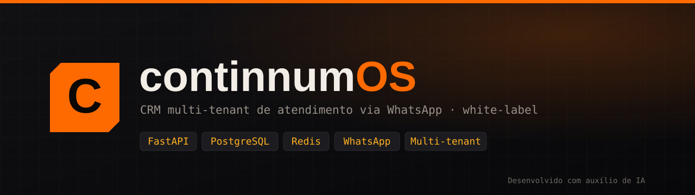
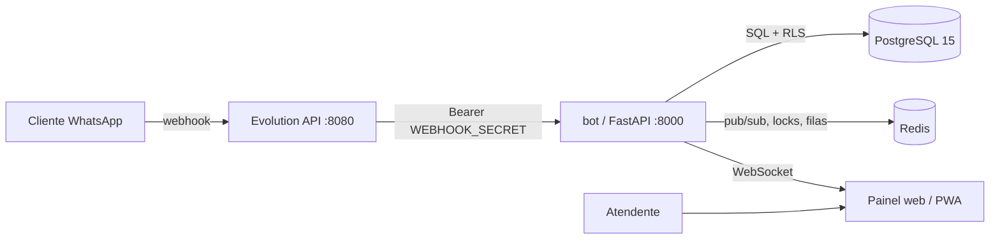

<p align="center">
  
</p>

<h1 align="center">continnumOS</h1>

<p align="center">
  <b>CRM multi-tenant de atendimento via WhatsApp para revenda white-label.</b><br>
  Centralize conversas, equipes, vendas e automa&#231;&#227;o em um &#250;nico console &#8212; cada cliente isolado no seu pr&#243;prio ambiente.
</p>

<p align="center">
  
  
  
  
  
  
  
  
</p>

<p align="center">
  <a href="#-vis&#227;o-geral">Vis&#227;o geral</a> &#183;
  <a href="#-recursos">Recursos</a> &#183;
  <a href="#&#65039;-arquitetura">Arquitetura</a> &#183;
  <a href="#-come&#231;ando">Come&#231;ando</a> &#183;
  <a href="#&#65039;-configura&#231;&#227;o">Configura&#231;&#227;o</a> &#183;
  <a href="#-estrutura">Estrutura</a> &#183;
  <a href="#&#65039;-roadmap-por-fases">Roadmap</a> &#183;
  <a href="#-testes--ci">Testes</a> &#183;
  <a href="#-documenta&#231;&#227;o">Docs</a>
</p>

---

## &#10024; Vis&#227;o geral

O **continnumOS** &#233; uma plataforma **SaaS multi-tenant** de atendimento via WhatsApp, pensada para **revenda white-label**: uma &#250;nica instala&#231;&#227;o atende v&#225;rios clientes (tenants), cada um com dados **totalmente isolados** por *Row-Level Security* (RLS) no PostgreSQL.

Do primeiro "oi" no WhatsApp ao fechamento da venda, tudo acontece em um console em tempo real: caixa unificada omnichannel, CRM de vendas, produtividade da equipe (SLA, filas, QA, gamifica&#231;&#227;o), IA/copiloto, billing, LGPD e API p&#250;blica.

> **Stack:** FastAPI &#183; PostgreSQL 15 &#183; Redis &#183; Evolution API (WhatsApp) &#183; Docker Compose &#183; PWA em tempo real (WebSocket).

## &#129513; Recursos

| &#193;rea | O que entrega |
| --- | --- |
| **Atendimento** | Caixa unificada com hist&#243;rico, m&#237;dia, respostas r&#225;pidas, encaminhamento, rea&#231;&#245;es e edi&#231;&#227;o &#8212; em tempo real via WebSocket. |
| **Omnichannel** | WhatsApp, Telegram, Instagram, Messenger, e-mail e webchat em uma caixa &#250;nica; segmentos e campanhas. |
| **Vendas & CRM** | Pipeline Kanban, cat&#225;logo, carrinho com link de pagamento, cad&#234;ncias, metas, comiss&#245;es e vis&#227;o 360 do contato. |
| **Produtividade** | Filas e SLA, supervis&#227;o em tempo real, QA, gamifica&#231;&#227;o e escalas/presen&#231;a dos atendentes. |
| **IA** | Copiloto (sugerir/ajustar tom/resumir/traduzir), base de conhecimento (RAG) e construtor de fluxos no-code. |
| **Multi-tenant** | Isolamento por RLS: um tenant nunca acessa dados de outro. |
| **Billing** | Faturas, gateway de pagamento, suspens&#227;o autom&#225;tica por inadimpl&#234;ncia e portal do cliente. |
| **Governan&#231;a** | Auditoria, reten&#231;&#227;o de dados, exporta&#231;&#227;o/exclus&#227;o por titular (LGPD) e DPA. |
| **Extens&#227;o** | White-label (dom&#237;nio pr&#243;prio por cliente), API p&#250;blica e webhooks de sa&#237;da. |

## &#127959;&#65039; Arquitetura

O sistema sobe como **4 containers** orquestrados por um &#250;nico `docker-compose.yaml`.



| Container | Imagem | Papel |
| --- | --- | --- |
| `bot` | build local (`Dockerfile`) | A aplica&#231;&#227;o: painel, API e webhook. |
| `evolution_api` | `evoapicloud/evolution-api` | Gateway do WhatsApp. |
| `postgres_db` | `postgres:15-alpine` | Banco com isolamento por tenant (RLS). |
| `redis` | `redis:alpine` | Tempo real, travas, rate-limit, filas. |

## &#128640; Come&#231;ando

### Pr&#233;-requisitos

- Docker + Docker Compose
- 2 vCPU / 4 GB RAM (m&#237;nimo)

### Instala&#231;&#227;o r&#225;pida

```bash
# 1) configure o ambiente
cp .env.example .env
nano .env          # troque todos os valores 'troque-...'

# 2) suba o stack (4 containers)
docker compose up -d --build

# 3) verifique a sa&#250;de
curl http://localhost:8000/health
```

Acesse **http://localhost:8000** e fa&#231;a login com o `ADMIN_USERNAME` / `ADMIN_PASSWORD` definidos no `.env`.

> Passo a passo completo (Docker, `.env`, migrations, HTTPS, backups e primeiro acesso) no **[Guia de instala&#231;&#227;o & deploy](docs/deploy.html)**.

## &#9881;&#65039; Configura&#231;&#227;o

Toda a configura&#231;&#227;o vive no arquivo `.env` (modelo em `.env.example`). Destaques:

| Vari&#225;vel | Descri&#231;&#227;o |
| --- | --- |
| `DATABASE_URL` | Conex&#227;o com o PostgreSQL. |
| `REDIS_URL` | Conex&#227;o com o Redis. |
| `EVO_API_URL` / `EVO_API_KEY` | Gateway Evolution (WhatsApp). |
| `ADMIN_USERNAME` / `ADMIN_PASSWORD` | Primeiro admin, criado no boot. |
| `JWT_SECRET` / `WEBHOOK_SECRET` | Segredos de sess&#227;o e do webhook. |
| `RUN_DB_MIGRATIONS_ON_BOOT` | `false` em produ&#231;&#227;o (use Alembic). |
| `PAYMENT_PROVIDER` | `manual` / `stripe` / `mercadopago` / `asaas`. |

> Em produ&#231;&#227;o, prefira **segredos como arquivos** (`*_FILE` / `SECRETS_DIR`) em vez de `.env` plano. Nunca versione o `.env`.

## &#128194; Estrutura

```text
continnumOS/
&#9500;&#9472; main.py                 # App FastAPI: rotas, webhook, WebSocket, loops de fundo
&#9500;&#9472; database.py             # Acesso a dados + RLS multi-tenant + schema por fase
&#9500;&#9472; ai_engine.py            # IA: copiloto, RAG, an&#225;lise (Fase 10)
&#9500;&#9472; flow_engine.py          # Construtor de fluxos no-code (Fase 10)
&#9500;&#9472; channels.py             # Adaptadores omnichannel (Fase 11)
&#9500;&#9472; sales_engine.py         # Motor de vendas/CRM (Fase 12)
&#9500;&#9472; team_engine.py          # SLA, QA, gamifica&#231;&#227;o, presen&#231;a (Fase 13)
&#9500;&#9472; evolution_service.py    # Cliente da Evolution API (WhatsApp)
&#9500;&#9472; tenant_context.py       # Contexto/isolamento de tenant
&#9500;&#9472; auth.py / permissions.py # Autentica&#231;&#227;o e permiss&#245;es
&#9500;&#9472; config.py               # Configura&#231;&#227;o via ambiente/segredos
&#9500;&#9472; services/               # storage, payments, ratelimit, jobqueue, webhooks, observability
&#9500;&#9472; templates/ + static/    # Frontend do painel (Jinja + JS + PWA)
&#9500;&#9472; site/                   # Site p&#250;blico (landing + docs, est&#225;tico)
&#9500;&#9472; migrations/             # Alembic (schema versionado)
&#9500;&#9472; tests/                  # Testes (inclui isolamento RLS)
&#9500;&#9472; scripts/                # backup/restore por tenant
&#9492;&#9472; docker-compose.yaml     # Orquestra&#231;&#227;o dos 4 servi&#231;os
```

## &#128506;&#65039; Roadmap por fases

| Fase | Tema | Status |
| --- | --- | :---: |
| 0&#8211;5 | Base do CRM, multi-tenant, m&#237;dia, observabilidade | &#9989; |
| 6 | Prontid&#227;o de produ&#231;&#227;o (CI, RLS, Alembic, pagamento, rate-limit, segredos) | &#9989; |
| 7 | Confiabilidade e escala (workers, filas, m&#233;tricas, alertas, DR) | &#9989; |
| 8 | Produto & GTM (signup, billing, onboarding, LGPD) | &#9989; |
| 9 | Diferenciais (analytics, API p&#250;blica, webhooks, white-label) | &#9989; |
| 10 | IA & fluxos no-code | &#9989; |
| 11 | Omnichannel | &#9989; |
| 12 | Vendas & CRM avan&#231;ado | &#9989; |
| 13 | Produtividade da equipe (SLA, QA, gamifica&#231;&#227;o) | &#9989; |

> Detalhes de cada entrega em [`CHANGELOG_SAAS.md`](CHANGELOG_SAAS.md).

## &#129514; Testes & CI

```bash
pip install -r requirements-dev.txt
pytest                     # su&#237;te completa
RUN_DB_TESTS=1 pytest      # inclui integra&#231;&#227;o + isolamento RLS (precisa Postgres/Redis)
```

O pipeline de **CI** (GitHub Actions em `.github/workflows/ci.yml`) sobe PostgreSQL e Redis reais e executa os testes, incluindo o de **isolamento RLS entre tenants**.

## &#128218; Documenta&#231;&#227;o

| Documento | Conte&#250;do |
| --- | --- |
| [`docs/deploy.html`](docs/deploy.html) | Guia visual de instala&#231;&#227;o & deploy. |
| [`docs/API_PUBLICA.md`](docs/API_PUBLICA.md) | API p&#250;blica e webhooks de sa&#237;da. |
| [`docs/CLIENTE.md`](docs/CLIENTE.md) | Guia do cliente final. |
| [`WHITELABEL.md`](WHITELABEL.md) | White-label e dom&#237;nio pr&#243;prio. |
| [`LGPD.md`](LGPD.md) / [`DPA.md`](DPA.md) | Conformidade e tratamento de dados. |
| [`DR.md`](DR.md) | Backups e recupera&#231;&#227;o de desastres. |
| [`CONTRIBUTING.md`](CONTRIBUTING.md) | Como contribuir. |
| [`SECURITY.md`](SECURITY.md) | Pol&#237;tica de seguran&#231;a. |

## &#129302; Desenvolvido com aux&#237;lio de IA

Este projeto foi **desenvolvido com o aux&#237;lio de intelig&#234;ncia artificial** em parte do seu ciclo (arquitetura, gera&#231;&#227;o e revis&#227;o de c&#243;digo, documenta&#231;&#227;o e testes). Todas as decis&#245;es finais, valida&#231;&#227;o e responsabilidade pela opera&#231;&#227;o s&#227;o humanas.

## &#128196; Licen&#231;a

**Propriet&#225;rio &#8212; todos os direitos reservados.** &#169; 2026 continnumOS. O uso, c&#243;pia ou distribui&#231;&#227;o requer autoriza&#231;&#227;o. Ajuste este trecho conforme o modelo de licenciamento desejado (ver [`LICENSE`](LICENSE)).
